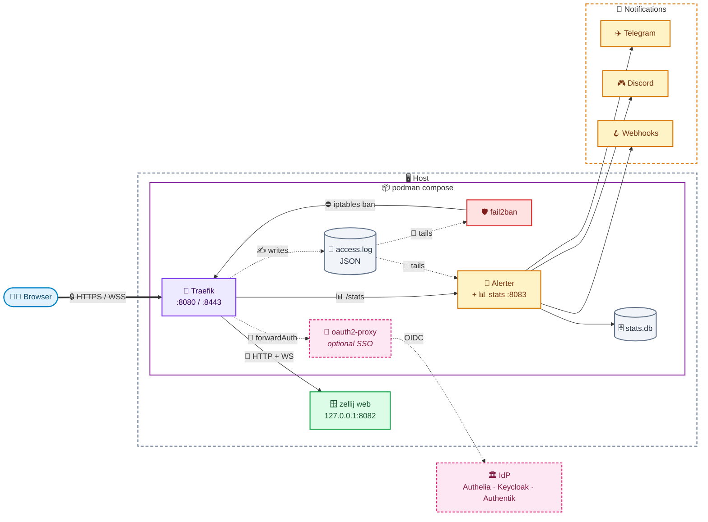
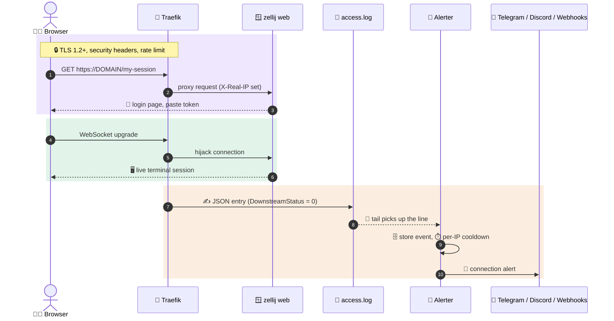

<div align="center">

# 🔒 secure-zellij

**Expose [zellij](https://zellij.dev) web terminal sessions over HTTPS with real-time connection alerts.**

[](https://github.com/thereisnotime/secure-zellij/actions/workflows/ci.yml)
[](LICENSE)
[](https://github.com/thereisnotime/secure-zellij/commits/main)
[](https://github.com/thereisnotime/secure-zellij/issues)
[](https://traefik.io)
[](https://python.org)
[](https://podman.io)

</div>

---

A podman compose stack that puts [Traefik](https://traefik.io) in front of the [zellij web terminal](https://zellij.dev/documentation/controlling-zellij-through-cli#web-server), handles TLS (self-signed or Let's Encrypt), and fires real-time alerts to Telegram and/or any webhook whenever someone successfully connects.

## Features

- **TLS out of the box** — self-signed by default, one config change to switch to Let's Encrypt
- **Real IP forwarding** — `X-Real-IP` / `X-Forwarded-For` correctly extracted and passed through
- **Connection alerts** — fires on WebSocket connections, not page loads, so only actual terminal sessions trigger notifications
- **Telegram, Discord + generic webhooks** — structured JSON payload with IP, user agent, path, and timestamp
- **Security headers** — HSTS, CSP, XSS protection, clickjacking protection
- **Optional SSO** — Authelia, Keycloak, Authentik (or any OIDC IdP) in front of zellij via oauth2-proxy or native forward-auth
- **Strict TLS** — TLS 1.2 minimum, modern cipher suites, SNI strict mode

## Architecture



Zellij runs on the **host** (not containerised). Traefik and fail2ban use host networking, so Traefik proxies straight to `127.0.0.1:8082`; the alerter publishes its stats dashboard on `127.0.0.1:8083`.

### Connection flow



## Requirements

- [podman](https://podman.io) ≥ 4.0
- [podman-compose](https://github.com/containers/podman-compose)
- [just](https://just.systems) (command runner)
- [zellij](https://zellij.dev) installed on the host with web server started

## Quick Start

```bash
# 1. Copy and configure environment
cp .env.example .env
$EDITOR .env          # set DOMAIN at minimum

# 2. Start zellij web server on the host (if not already running)
zellij web --start -d

# 3. Start the stack
just up

# 4. Generate a login token
just token
```

Open `https://<DOMAIN>` and paste the token. Done.

## Configuration

Copy `.env.example` to `.env` and edit:

| Variable | Required | Default | Description |
|---|---|---|---|
| `DOMAIN` | ✅ | — | Domain Traefik will serve (e.g. `zellij.example.com`) |
| `HTTP_PORT` | | `80` | Host port for HTTP (redirect to HTTPS) |
| `HTTPS_PORT` | | `443` | Host port for HTTPS |
| `ACME_EMAIL` | LE only | — | Email for Let's Encrypt certificate |
| `TELEGRAM_BOT_TOKEN` | | — | Bot token from [@BotFather](https://t.me/BotFather) |
| `TELEGRAM_CHAT_ID` | | — | Chat or channel ID for alerts |
| `WEBHOOK_URLS` | | — | Comma-separated webhook URLs |
| `WEBHOOK_BODY_TEMPLATE` | | — | JSON template for webhook body (see [Alerting](docs/alerting.md)) |
| `SSO_MODE` | | `off` | `oauth2-proxy` or `forward-auth` to put an IdP login in front (see [SSO](docs/sso.md)) |

## TLS Modes

### Self-signed (default)

No changes needed. Traefik auto-generates a self-signed cert. The browser will show a security warning — accept it, or add the cert to your trust store.

### Let's Encrypt

1. **`traefik/traefik.yml`** — uncomment the `certificatesResolvers` block and set your email:
   ```yaml
   certificatesResolvers:
     letsencrypt:
       acme:
         email: "you@example.com"
         storage: /letsencrypt/acme.json
         httpChallenge:
           entryPoint: web
   ```

2. **`traefik/dynamic/routers.yml`** — swap `tls: {}` for:
   ```yaml
   tls:
     certResolver: letsencrypt
   ```

3. Set `ACME_EMAIL` in `.env`.

4. Ensure port `80` is reachable from the internet for the HTTP-01 challenge.

## Alerting

Alerts fire on every WebSocket connection, i.e. when a terminal session is established. Traefik logs hijacked WebSocket connections with `DownstreamStatus: 0`, which is what `ALERT_ON_STATUS` matches by default.

### Telegram

Create a bot via [@BotFather](https://t.me/BotFather), then set:

```env
TELEGRAM_BOT_TOKEN=123456:ABC-your-token
TELEGRAM_CHAT_ID=-1001234567890
```

Example alert message:
```
🔌 Zellij connection
IP: `1.2.3.4`
Path: `/my-session`
UA: `Mozilla/5.0 (X11; Linux x86_64) ...`
Time: `2026-01-01T22:00:00+00:00`
```

### Generic webhooks

```env
WEBHOOK_URLS=https://hooks.example.com/zellij,https://n8n.example.com/webhook/abc
```

Payload sent to each URL via `POST`:

```json
{
  "event": "zellij_connect",
  "timestamp": "2026-01-01T22:00:00+00:00",
  "client_ip": "1.2.3.4",
  "x_forwarded_for": "",
  "user_agent": "Mozilla/5.0 ...",
  "path": "/my-session",
  "status": 0,
  "service": "zellij"
}
```

## Commands

```bash
just up             # start the stack
just down           # stop the stack
just restart        # restart all services
just build          # rebuild images (no cache)
just pull           # pull latest upstream images
just clean          # destroy containers and volumes

just logs           # follow all logs
just logs-traefik   # follow Traefik logs
just logs-alerter   # follow alerter logs

just token          # generate a zellij web login token
just tokens         # list existing tokens
just status         # show zellij + container status

just lint           # lint alerter Python (ruff check + format)
just format         # auto-format alerter Python
just test           # run alerter unit tests
just validate       # validate compose.yaml

just sso-check      # check SSO settings and IdP discovery (docs/sso.md)
just sso-cookie-secret  # generate SSO_COOKIE_SECRET
just logs-sso       # follow oauth2-proxy logs
just test-sso       # SSO end-to-end test with a mock IdP
```

## Documentation

| | |
|---|---|
| [Runbook](RUNBOOK.md) | Day-to-day operations: stack, tokens, fail2ban, diagnostics |
| [TLS Configuration](docs/tls.md) | Self-signed, Let's Encrypt, DNS-01, BYO cert, hardening |
| [Alerting](docs/alerting.md) | Telegram, Discord, webhooks, dedup cooldown |
| [Integrations](docs/integrations.md) | n8n, Slack, ntfy.sh, Home Assistant |
| [SSO](docs/sso.md) | Authelia, Keycloak, Authentik login in front of zellij |
| [Fail2ban](docs/fail2ban.md) | Automatic IP banning, tuning, GitOps config |
| [IP Allowlist](docs/ip-allowlist.md) | Restrict access to specific IPs/CIDRs |
| [Log Rotation](docs/log-rotation.md) | Logrotate setup, portable install |
| [Multi-domain & LAN Access](docs/multi-domain.md) | EXTRA_DOMAINS, LAN IP, local DNS, tunnels |
| [Systemd Service](docs/systemd.md) | Auto-start on login or boot |

## Project Structure

```
.
├── justfile                    # command runner
├── compose.yaml                # podman compose stack
├── .env.example                # environment template
├── docs/                       # advanced usage documentation
├── traefik/
│   ├── traefik.yml             # static config (entrypoints, access log)
│   ├── entrypoint.sh           # builds multi-domain Host rule + SSO wiring at startup
│   ├── sso/                    # forwardAuth templates per SSO_MODE
│   └── dynamic/
│       ├── routers.yml         # routing rules + backend (host:8082)
│       ├── middlewares.yml     # security headers, real-IP extraction
│       └── tls.yml             # TLS options (min version, ciphers)
├── tests/
│   └── sso-e2e.sh              # SSO end-to-end test (mock IdP)
├── alerter/
│   ├── alerter.py              # log tailer + alert dispatcher
│   ├── pyproject.toml          # dependencies + ruff config
│   ├── uv.lock
│   └── Dockerfile
└── .github/
    └── workflows/
        └── ci.yml
```

## Security Notes

- Zellij token authentication is handled by the zellij web server. Optionally, [SSO](docs/sso.md) puts an IdP login in front of it; zellij still asks for its token afterwards.
- HTTP permanently redirects to HTTPS; plain-text connections are not served.
- TLS 1.2 minimum; TLS 1.0/1.1 are disabled.
- For production deployments, use Let's Encrypt or a CA-signed cert. Self-signed certs expose users to MITM if browser warnings are bypassed.

## License

[MIT](LICENSE) © [thereisnotime](https://github.com/thereisnotime)
