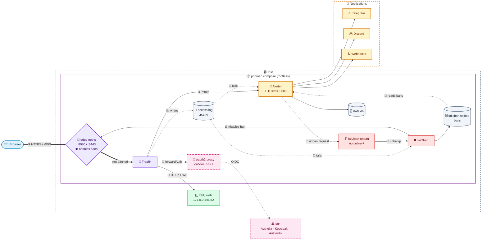
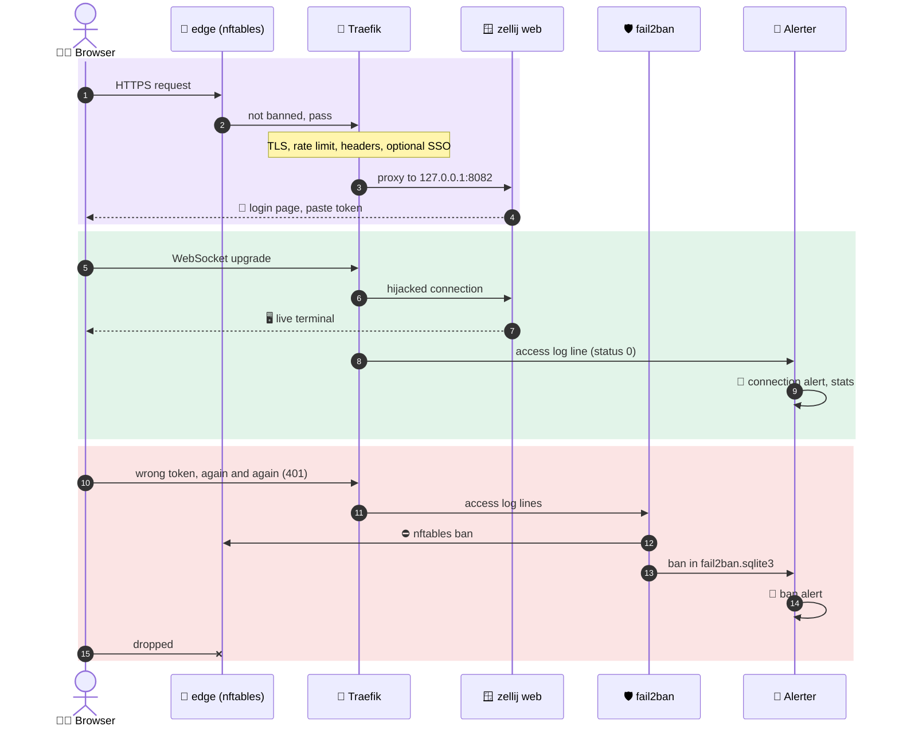

<div align="center">

# 🔒 secure-zellij

**Put your [zellij](https://zellij.dev) web terminal on the internet without losing sleep over it.**

[](https://github.com/thereisnotime/secure-zellij/actions/workflows/ci.yml)
[](LICENSE)
[](https://github.com/thereisnotime/secure-zellij/commits/main)
[](https://traefik.io)
[](https://python.org)
[](https://podman.io)
[](docs/selinux.md)

[Quick start](#quick-start) · [Security model](#security-model) · [Configuration](docs/configuration.md) · [Runbook](RUNBOOK.md) · [Docs](#documentation)

</div>

---

secure-zellij is a rootless podman compose stack that serves the
[zellij web client](https://zellij.dev/documentation/controlling-zellij-through-cli#web-server) over HTTPS.
It puts layers in front of zellij's own token login: TLS, rate limiting,
automatic IP bans and optional single sign-on. It tells you when someone
connects or gets banned, and shows it all on a small dashboard. Everything runs
as your user, with no root and no host firewall changes. It works on SELinux
hosts in enforcing mode.

## Features

**🔐 Access**
- HTTPS with a self-signed cert out of the box, or Let's Encrypt ([TLS](docs/tls.md))
- TLS 1.2+, modern ciphers, HSTS and strict security headers, HTTP redirected to HTTPS
- Optional SSO with Authelia, Keycloak, Authentik or any OIDC provider ([SSO](docs/sso.md))
- Several hostnames or LAN IPs per install ([multi-domain](docs/multi-domain.md)), optional IP allowlist ([allowlist](docs/ip-allowlist.md))

**🛡️ Protection**
- Per-client rate limit in Traefik
- fail2ban bans clients that rack up failed logins. The bans drop packets with nftables in the stack's own network namespace ([fail2ban](docs/fail2ban.md))
- Real client IPs end to end; a client-supplied `X-Real-Ip` is stripped
- Unban from the dashboard through a helper container with no network that can only run `unbanip`

**🔔 Visibility**
- Alerts to Telegram, Discord and any webhook when a terminal session opens, an IP is banned or an unban happens ([alerting](docs/alerting.md))
- The signed-in SSO user in every alert
- `/stats` dashboard: sessions, recent connections, active bans, unban button

**⚙️ Operations**
- One command to upgrade (`just upgrade`); healthchecks on Traefik, fail2ban, the unban helper and the alerter
- Works with podman-compose and docker-compose; runs on Ubuntu, Linux Mint and Fedora with SELinux enforcing
- End-to-end tests for SSO, bans and unbans in CI, plus a [benchmark](docs/performance.md): about 160 MiB of RAM idle, ~22% of one core for a client at the rate limit

## Security model

Layers a request passes through, from the internet inwards:

| Layer | What it does | Docs |
|---|---|---|
| 🧱 **edge namespace** | Owns the published ports. fail2ban's nftables rules drop banned IPs here, before Traefik sees a byte. | [fail2ban](docs/fail2ban.md#where-the-ban-happens) |
| 🔒 **TLS** | TLS 1.2+ only, HTTP redirects to HTTPS, HSTS. | [TLS](docs/tls.md) |
| 🚦 **Traefik** | Rate limit per client, security headers, strips spoofable forwarding headers, access log with cookies and credentials redacted. | [configuration](docs/configuration.md#files-you-might-edit) |
| 🏛️ **SSO** (optional) | Your IdP's login and group check before any request reaches zellij or `/stats`. | [SSO](docs/sso.md) |
| 🔑 **zellij token** | zellij's own login token. It's still required with SSO; zellij has no way to trust a proxy's login yet. | [runbook](RUNBOOK.md) |

Failed logins and unauthenticated requests (HTTP 4xx) count towards a ban: 10
within 60 seconds bans the client for an hour by default. With oauth2-proxy, a
browser that isn't signed in gets a redirect to the IdP, not a 4xx, so just
visiting the page never gets anyone banned.

**What it doesn't do:** it doesn't inspect what happens inside a terminal session,
and it's not a WAF. Anyone holding a valid zellij token (and SSO login, if enabled)
gets a shell as the user running zellij. Treat tokens like SSH keys.

## Architecture



zellij runs directly on the host, not in a container. The `edge` container owns
the published ports and a network namespace (podman's pasta network, which keeps
real client IPs). Traefik and fail2ban share that namespace, so fail2ban's
nftables bans apply to Traefik's traffic without root. pasta forwards Traefik's
requests to zellij and the alerter on the host's loopback.

### What happens on a connection



## Requirements

| | |
|---|---|
| OS | Linux with cgroups v2 and nftables. Runs on Ubuntu 24.04, Linux Mint 22 and Fedora 43 (SELinux enforcing). |
| [podman](https://podman.io) | 4.4 or newer, rootless, with pasta (package `passt`, included with podman 5) |
| Compose | `podman compose` with either docker-compose v2 or podman-compose 1.x behind it |
| [just](https://just.systems) | Runs the recipes. Version pinned in `.tool-versions`. |
| [zellij](https://zellij.dev) | With the web server (`zellij web`), on the host. Used with 0.45 and 0.46. |

No root is needed at any point.

## Quick start

```bash
git clone https://github.com/thereisnotime/secure-zellij.git
cd secure-zellij

cp .env.example .env
$EDITOR .env               # set DOMAIN; ports default to 8080/8443

just start                 # zellij web server on the host + the stack
just token                 # create a login token
```

Open `https://<DOMAIN>:8443`, accept the self-signed certificate and paste the
token. To serve on 443, forward it to 8443 or see [Ports](docs/configuration.md#ports).

Then, depending on what you need:
- Real certificate: [TLS](docs/tls.md)
- Alerts: set `TELEGRAM_*`, `DISCORD_WEBHOOK_URL` or `WEBHOOK_URLS` ([alerting](docs/alerting.md))
- Dashboard login: set `STATS_USERNAME` and `STATS_PASSWORD` (this also enables the unban button)
- SSO: [SSO](docs/sso.md)
- Start on boot: [systemd](docs/systemd.md)

## Configuration

Everything is in `.env`. The settings you're most likely to touch:

| Variable | Default | Description |
|---|---|---|
| `DOMAIN` | required | Hostname to serve |
| `EXTRA_DOMAINS` | empty | More hostnames or IPs, comma-separated |
| `HTTP_PORT` / `HTTPS_PORT` | `8080` / `8443` | Published ports |
| `TELEGRAM_BOT_TOKEN`, `TELEGRAM_CHAT_ID` | empty | Telegram alerts |
| `DISCORD_WEBHOOK_URL`, `WEBHOOK_URLS` | empty | Discord and generic webhook alerts |
| `STATS_USERNAME`, `STATS_PASSWORD` | empty | Dashboard login, also enables the unban button |
| `SSO_MODE` | `off` | `oauth2-proxy` or `forward-auth` |

The full reference, including SSO and network options, is in
[docs/configuration.md](docs/configuration.md).

## Commands

```bash
just start        # zellij web server + stack       just stop       # both
just up           # stack only                      just down       # stack only
just restart      # recreate after .env changes     just upgrade    # git pull + rebuild + recreate
just status       # zellij, sessions, containers    just logs       # follow all logs

just token        # new login token                 just tokens     # list tokens
just revoke NAME  # revoke one token                just token-ro   # read-only token

just fail2ban-banned        # who is banned         just fail2ban-unban IP
just access 50              # last 50 access log entries
just selinux-check          # labels and health on SELinux hosts
just sso-check              # validate SSO settings and print the redirect URI
```

`just` with no arguments lists every recipe. Day-to-day procedures are in the
[runbook](RUNBOOK.md).

## Testing

| Command | What it checks | In CI |
|---|---|---|
| `just lint`, `just test` | ruff and the alerter's unit tests | ✅ |
| `just test-filter` | The fail2ban regex against sample Traefik lines: 4xx boundaries, IPv6, spoofing | ✅ |
| `just test-ban` | A client gets banned, is then dropped, stays dropped across a Traefik restart, gets back in after unban | ✅ |
| `just test-unban` | The dashboard unban path and its guards (login, CSRF, jail allowlist) | ✅ |
| `just test-sso` | Login flow with a mock IdP for both SSO modes, header spoofing, misconfiguration | ✅ |
| `just bench` | CPU, memory and filter cost ([performance](docs/performance.md)) | |

The end-to-end tests use throwaway `sz-*` containers on spare ports and never
touch a running stack. CI runs on Ubuntu; run the tests on an SELinux host too
after changing mounts ([SELinux](docs/selinux.md#testing-on-selinux)).

## Documentation

| Guide | |
|---|---|
| [Configuration](docs/configuration.md) | Every variable, ports, files you might edit |
| [Runbook](RUNBOOK.md) | Day-to-day operations and troubleshooting |
| [TLS](docs/tls.md) | Self-signed, Let's Encrypt, DNS-01, your own certificate |
| [SSO](docs/sso.md) | Authelia, Keycloak, Authentik, any OIDC provider |
| [Fail2ban](docs/fail2ban.md) | What gets banned, how bans are enforced, tuning, unbanning |
| [Alerting](docs/alerting.md) | Channels, payloads, templates, ban and unban alerts |
| [Integrations](docs/integrations.md) | n8n, Slack, ntfy, Home Assistant |
| [Multi-domain & LAN](docs/multi-domain.md) | Extra hostnames, LAN IPs, tunnels |
| [IP allowlist](docs/ip-allowlist.md) | Restrict access to known networks |
| [SELinux](docs/selinux.md) | Enforcing-mode hosts, labels, debugging denials |
| [Systemd](docs/systemd.md) | Start on login or boot |
| [Log rotation](docs/log-rotation.md) | Keep the access log in check |
| [Performance](docs/performance.md) | Measured CPU, memory, disk, fail2ban filter benchmark |

## Project layout

```text
.
├── compose.yaml              # the stack: edge, traefik, fail2ban, fail2ban-unban, alerter, oauth2-proxy
├── justfile                  # every operation, `just` lists them
├── .env.example              # configuration template
├── traefik/
│   ├── traefik.yml           # entrypoints, access log, ACME
│   ├── entrypoint.sh         # builds host rules and SSO wiring at start
│   ├── dynamic/              # routers, middlewares, TLS options
│   └── sso/                  # forwardAuth templates per SSO_MODE
├── fail2ban/
│   ├── filter.d/             # what counts as a failure
│   ├── jail.d/               # thresholds, nftables action
│   └── unban-helper.py       # runs dashboard unbans (fail2ban-unban)
├── alerter/                  # alerts + /stats dashboard (Python, FastAPI)
├── tests/                    # end-to-end tests, filter check, benchmark
├── docs/                     # guides
└── RUNBOOK.md                # operations
```

## Contributing

Issues and pull requests are welcome. [CONTRIBUTING.md](CONTRIBUTING.md) covers
the development setup, tests and conventions. Report vulnerabilities privately as
described in [SECURITY.md](SECURITY.md). Changes are listed in
[CHANGELOG.md](CHANGELOG.md).

## License

[MIT](LICENSE) © [thereisnotime](https://github.com/thereisnotime)
