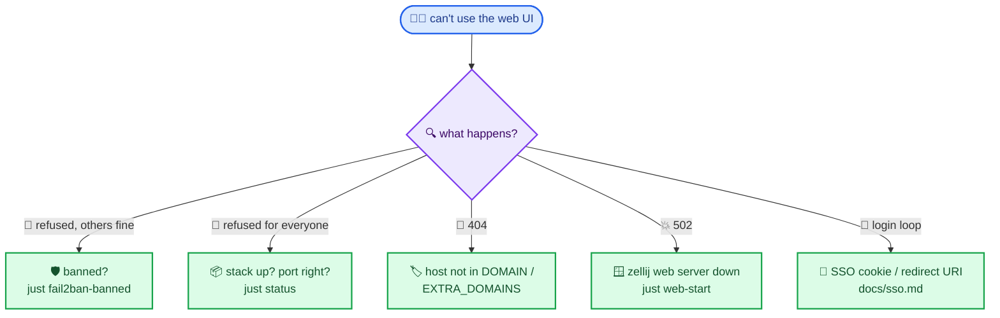

# Runbook

Day-to-day operations for a running secure-zellij install: starting and upgrading the stack, tokens, bans, health, logs and the failures you are most likely to hit. Setup and configuration are in the [README](README.md) and [docs/](docs/README.md).

All commands run from the repo directory. `just` loads `.env` from there, and `just --list` shows every recipe.

## What runs where

| Name | Where | What it does |
|---|---|---|
| zellij web server | host, `127.0.0.1:8082` | Serves the terminal sessions. Started by `just start` or `just web-start`, not by compose. |
| `secure-zellij-edge` | container | Owns the network namespace Traefik and fail2ban share, and the published ports (`HTTP_PORT` / `HTTPS_PORT`). Runs only a sleep loop. |
| `secure-zellij-traefik` | in edge's namespace | TLS, routing, security headers, rate limit, JSON access log |
| `secure-zellij-fail2ban` | in edge's namespace | Reads the access log, bans IPs with nftables inside that namespace |
| `secure-zellij-fail2ban-unban` | container, no network | Runs unban requests from the dashboard against fail2ban's socket |
| `secure-zellij-alerter` | container, `127.0.0.1:8083` | Alerts (Telegram, Discord, webhooks), `/stats` dashboard |
| `secure-zellij-oauth2-proxy` | host network, `127.0.0.1:${SSO_PROXY_PORT}` | Only with `SSO_MODE=oauth2-proxy` |

## Stack

```bash
just start      # compose up -d, start the zellij web server, print status
just stop       # compose down, stop the zellij web server
just up         # compose up -d (containers only)
just down       # compose down (containers only)
just restart    # recreate every container (up -d --force-recreate)
just status     # zellij web server, URLs, sessions, tokens, containers
just open       # open https://DOMAIN:HTTPS_PORT in the browser
```

`just up` and `just down` leave the zellij web server alone, so sessions and the web server survive a container restart. `just stop`, `just down` and `just clean` always include the `sso` profile, so they also remove oauth2-proxy after you turned SSO off.

`just status` and `just open` fall back to different ports when `HTTPS_PORT` is unset (443 and 8443). Set `HTTPS_PORT` in `.env` and both print the right URL.

### Applying changes

| What changed | Run |
|---|---|
| `.env` | `just up`. Containers whose settings changed are recreated. |
| `SSO_MODE` | `just down && just up`, so oauth2-proxy is started or removed |
| `traefik/traefik.yml`, `traefik/dynamic/`, `traefik/sso/` | `podman compose restart traefik`. These are not hot-reloaded: `traefik/entrypoint.sh` renders them once at startup. |
| `fail2ban/filter.d/`, `fail2ban/jail.d/` | `just test-filter`, then `podman compose restart fail2ban` |
| `alerter/` | `podman compose up -d --build alerter` |
| `edge` recreated (or anything odd with networking) | `just restart`. Traefik and fail2ban lose their network when `edge` is replaced under them. |

### Upgrading

```bash
just upgrade    # git pull --ff-only, then up -d --build --force-recreate
```

This pulls the repo, rebuilds the alerter and recreates every container, so changed bind-mounted configs and the new images are all picked up. `git pull --ff-only` stops if you have local edits to files that changed upstream: commit them on a branch or `git stash` first. Settings that live in an untracked `compose.override.yaml` don't get in the way.

Other image and build recipes:

```bash
just pull       # pull the pinned upstream images
just build      # rebuild the alerter image without cache
just clean      # down -v: removes containers AND volumes (certificates, stats, ban history)
```

### zellij versions

The web UI only treats sessions started by its own zellij version as running. Sessions from another version show as exited, even though they are alive. After upgrading zellij, either restart the sessions on the new version, or pin the web server to the old binary in `.env` (`just status` prints the binary in use):

```dotenv
ZELLIJ_BIN=~/.local/opt/zellij-0.45.0/zellij
```

```bash
just web-stop && just web-start
```

## Tokens

Logging in to zellij needs a token, also with SSO on.

```bash
just token          # create a read-write token
just token-ro       # create a read-only token
just tokens         # list tokens with creation dates
just revoke <name>  # revoke one token (name from `just tokens`)
just revoke-all     # revoke every token
```

zellij picks the token name itself, so you can't name a token when you create it.

## Sessions

```bash
zellij list-sessions
zellij attach <name>
zellij kill-session <name>
zellij kill-all-sessions
```

Each session is also reachable at `https://DOMAIN:HTTPS_PORT/<name>`. `just status` lists them with their URLs.

## Bans

fail2ban bans an IP after `maxretry` 4xx responses within `findtime` (10 in 60 seconds by default) for `bantime` (one hour). The rule is an nftables `reject` in edge's network namespace, so a banned client's connections are refused before they reach Traefik, without an error page. Connections from the host itself are never banned (`ignoreself`). See [Fail2ban](docs/fail2ban.md).

```bash
just fail2ban-status            # jail summary: current and total failures and bans
just fail2ban-banned            # banned IPs with ban time and expiry
just fail2ban-unban 203.0.113.7 # unban one IP
```

Unbanning from the browser: the `/stats` dashboard has an unban button when `UNBAN_ENABLED=true` (the default) and the page has a login (`STATS_USERNAME`/`STATS_PASSWORD`, or SSO). The request goes through the `fail2ban-unban` helper and sends an unban alert.

More checks:

```bash
# is this IP banned? (1 or 0)
podman exec secure-zellij-fail2ban fail2ban-client get traefik-zellij banned 203.0.113.7

# ban by hand
podman exec secure-zellij-fail2ban fail2ban-client set traefik-zellij banip 203.0.113.7

# the actual nftables rules (in edge's namespace; `sudo nft list ruleset` on the host won't show them)
podman exec secure-zellij-fail2ban nft list ruleset

# run the filter over the live access log
podman exec secure-zellij-fail2ban fail2ban-regex \
  /var/log/traefik/access.log /etc/fail2ban/filter.d/traefik-zellij.conf
```

## Health

```bash
podman ps --filter name=secure-zellij --format '{{.Names}}\t{{.Status}}'
just selinux-check     # also lists each container's state and health, and pings fail2ban's socket
```

| Container | Healthcheck | Unhealthy usually means |
|---|---|---|
| `traefik` | `traefik healthcheck` (ping entrypoint) | Traefik failed to start or load its config, see `just logs-traefik` |
| `fail2ban` | `fail2ban-client ping` | The fail2ban server exited inside a running container, often its control socket (SELinux, [docs/selinux.md](docs/selinux.md)) |
| `fail2ban-unban` | `fail2ban-client ping` over the shared socket | fail2ban is down, or a label keeps the helper off the socket |
| `alerter` | `GET http://127.0.0.1:8083/health` | The alerter crashed, see `just logs-alerter` |
| `edge`, `oauth2-proxy` | none | Check that they are `Up` |

The alerter's health endpoint needs no login, so it works from the host too:

```bash
curl -fsS http://127.0.0.1:8083/health
```

## Logs

```bash
just logs                       # all containers, follow
just logs-traefik
just logs-alerter
just logs-sso                   # oauth2-proxy (SSO_MODE=oauth2-proxy)
podman compose logs -f fail2ban # bans and unbans as fail2ban sees them
just access                     # last 20 access log entries, the interesting fields
just access 100                 # last 100
```

The access log is on the `traefik-logs` volume. To read it raw:

```bash
LOG="$(podman volume inspect secure-zellij_traefik-logs --format '{{.Mountpoint}}')/access.log"
tail -f "$LOG" | python3 -c 'import sys, json; [print(json.dumps(json.loads(l), indent=2), flush=True) for l in sys.stdin if l.strip()]'
```

Rotate it with logrotate, see [Log rotation](docs/log-rotation.md):

```bash
just logrotate-install          # writes /etc/logrotate.d/secure-zellij (sudo)
just logrotate-run              # dry run
just logrotate-run force=true   # rotate now
```

## Dashboard and alerts

- Dashboard: `https://DOMAIN:HTTPS_PORT/stats`, or `http://127.0.0.1:8083/` on the host. Both use `STATS_USERNAME`/`STATS_PASSWORD` when set.
- A connection alert is sent when a terminal session's WebSocket closes, because that's when Traefik writes the log line. Ban and unban alerts are sent when they happen.
- Alert settings and troubleshooting: [Alerting](docs/alerting.md). Slack, ntfy, n8n, Home Assistant: [Integrations](docs/integrations.md).

## SSO

Setup per IdP: [SSO](docs/sso.md).

```bash
just sso-check          # mode, required settings, cookie secret, IdP discovery, redirect URI to register
just sso-cookie-secret  # generate SSO_COOKIE_SECRET
just logs-sso
```

Turning SSO off: set `SSO_MODE=off` in `.env`, then `just down && just up`.

## Certificates

```bash
echo | openssl s_client -connect "127.0.0.1:${HTTPS_PORT:-8443}" -servername "$DOMAIN" 2>/dev/null \
  | openssl x509 -noout -subject -issuer -dates
```

Let's Encrypt certificates renew on their own, 30 days before expiry. To force a new one, remove the stored certificates and restart Traefik. Mind Let's Encrypt's rate limits if you do this often:

```bash
podman compose stop traefik
rm "$(podman volume inspect secure-zellij_letsencrypt --format '{{.Mountpoint}}')/acme.json"
podman compose start traefik
```

Modes and setup: [TLS](docs/tls.md).

## SELinux

```bash
just selinux-check
sudo ausearch -m AVC -ts recent | audit2why
```

Shows the mode, whether every mounted path got `container_file_t`, each container's process label and health, and whether the unban helper reaches fail2ban's socket. See [SELinux](docs/selinux.md).

## Tests

All of these use throwaway containers or none at all, and leave the running stack alone.

```bash
just lint          # ruff check and format check (alerter, unban helper)
just test          # alerter unit tests
just validate      # compose.yaml, with and without the sso profile
just test-filter   # fail2ban filter against sample log lines
just test-ban      # a ban really blocks the client (real Traefik, fail2ban, nftables)
just test-unban    # dashboard unban button end to end
just test-sso      # SSO against a mock IdP
just bench         # benchmarks from docs/performance.md (all, stack or filter)
```

## Common failures



| Symptom | Cause and fix |
|---|---|
| Connection refused for one client, others are fine | The client's IP is banned. `just fail2ban-banned`, then `just fail2ban-unban <ip>` or the dashboard button. |
| 502 Bad Gateway | The zellij web server isn't running on `127.0.0.1:8082`. `just status`, then `just web-start`. |
| 404 page not found | The name in the URL isn't `DOMAIN` or in `EXTRA_DOMAINS`. See [Multiple domains](docs/multi-domain.md). |
| Sessions show as exited but are running | They were started by a different zellij version. See [zellij versions](#zellij-versions). |
| Traefik keeps restarting | An entrypoint error such as `SSO_MODE=forward-auth needs SSO_FORWARD_AUTH_URL` or `unknown SSO_MODE`. `just logs-traefik` shows it. |
| Traefik up but nothing answers, or fail2ban can't add rules, after `edge` was recreated | Traefik and fail2ban are still attached to the old namespace. `just restart`. |
| `fail2ban` unhealthy, nothing gets banned | The fail2ban server exited, usually over its socket on an SELinux host. `just selinux-check`, [docs/selinux.md](docs/selinux.md). |
| Unban button missing or disabled | `UNBAN_ENABLED=false`, or the dashboard has no login. Set `STATS_USERNAME`/`STATS_PASSWORD` or enable SSO. |
| No alerts | Alerts for a session arrive when it closes. Otherwise check `just logs-alerter` for send errors and the startup config summary. |
| Every recipe fails with `failed to load environment file` | A value in `.env` that `just` can't parse, usually an unquoted `WEBHOOK_BODY_TEMPLATE`. Wrap it in single quotes ([Integrations](docs/integrations.md#writing-a-body-template)). |
| `just up` fails binding a port | Another process holds `HTTP_PORT`/`HTTPS_PORT`, or the port is below 1024 on rootless podman ([TLS](docs/tls.md#lets-encrypt-http-01)). |
| `just upgrade` stops at `git pull` | Local edits to files that changed upstream. Commit or stash them and run it again. |
| No bans or alerts after a log rotation | An old logrotate config that renamed the log. Reinstall it, see [Log rotation](docs/log-rotation.md#troubleshooting). |
