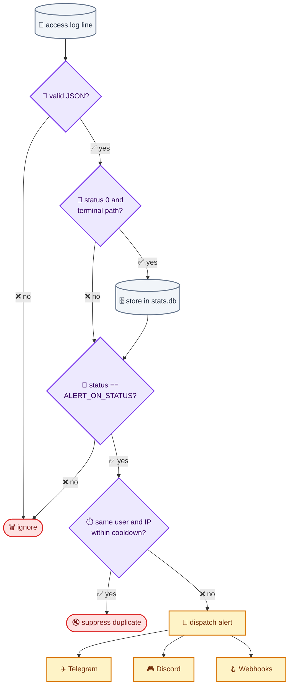

# Alerting

The `alerter` container sends a notification when someone opens a zellij terminal session, when fail2ban bans an IP, and when an admin lifts a ban from the dashboard. It also serves the `/stats` dashboard.

This page covers the notification channels (Telegram, Discord, generic webhooks), the three alert types, webhook payloads and templates, how the signed-in SSO user gets into alerts, deduplication and the dashboard. Ready-made webhook setups for n8n, Slack, ntfy and Home Assistant are in [Integrations](integrations.md).

- [How it works](#how-it-works)
- [Channels](#channels)
- [Connection alerts](#connection-alerts)
- [Ban alerts](#ban-alerts)
- [Unban alerts](#unban-alerts)
- [Webhook payload](#webhook-payload)
- [Webhook body template](#webhook-body-template)
- [SSO user](#sso-user)
- [Alert deduplication](#alert-deduplication)
- [Stats dashboard](#stats-dashboard)
- [Logs](#logs)
- [Troubleshooting](#troubleshooting)
- [Reference](#reference)

## How it works

The alerter has three sources of events:

| Event | Source | `event` field |
|---|---|---|
| Terminal session | Traefik's JSON access log (`traefik-logs` volume, read-only) | `zellij_connect` |
| fail2ban ban | fail2ban's SQLite database (`fail2ban-data` volume, read-only), polled every 5 seconds | `fail2ban_ban` |
| Dashboard unban | the unban button on `/stats` | `fail2ban_unban` |

For the access log, the alerter tails `access.log` and handles each new line like this:

1. Lines that aren't valid JSON are ignored.
2. A line with `DownstreamStatus` 0 on a terminal path (`/ws/terminal` or `/ws/terminal/<session>`) is stored in `stats.db` for the dashboard. Traefik logs WebSocket connections with status 0, and writes the entry when the connection **closes**.
3. If `DownstreamStatus` equals `ALERT_ON_STATUS` (default `0`) and the client isn't in its [cooldown window](#alert-deduplication), the alert goes out to every configured channel.



Ban and unban alerts skip the cooldown and go straight to dispatch.

## Channels

Every configured channel gets every alert. Set only the variables for the channels you want and leave the rest empty. A failed send (network error, bad token) is logged to stderr and doesn't stop the alerter.

### Telegram

1. Create a bot with [@BotFather](https://t.me/BotFather): send `/newbot`, follow the prompts and copy the token.
2. Send the bot a message, then open:

   ```text
   https://api.telegram.org/bot<TOKEN>/getUpdates
   ```

   The `chat.id` field in the response is your chat ID. Channel IDs are numeric and start with `-100`.
3. Set both in `.env`:

   ```env
   TELEGRAM_BOT_TOKEN=123456789:ABCdefGhIJKlmNoPQRsTUVwxyZ
   TELEGRAM_CHAT_ID=-1001234567890
   ```

Messages use Telegram's Markdown: the title is bold and values are in code spans.

### Discord

In your Discord server open **Server Settings → Integrations → Webhooks → New Webhook** and copy the URL:

```env
DISCORD_WEBHOOK_URL=https://discord.com/api/webhooks/1234567890/xxxxxxxxxxxx
```

The alerter posts Discord's native format (`{"content": "..."}`), so no template is needed. The text is the same as Telegram's, with a bold title and plain values.

### Generic webhooks

Any number of HTTP endpoints, comma-separated:

```env
WEBHOOK_URLS=https://n8n.example.com/webhook/abc,https://hooks.example.com/zellij
```

Each URL gets a POST with a JSON body, see [Webhook payload](#webhook-payload). For services that expect a different shape, use a [body template](#webhook-body-template). Any 4xx or 5xx answer is logged as a failure.

## Connection alerts

A connection alert means someone had a terminal session open, not just loaded the login page. Because Traefik writes WebSocket entries when the connection closes, the alert arrives when the session's WebSocket ends (closing the tab, a reconnect, a network drop), and `Time` is that moment.

Telegram:

```text
🔌 Zellij connection
User: `alice <alice@example.com>`
IP: `198.51.100.10`
Path: `/ws/terminal/my-session`
UA: `Mozilla/5.0 (X11; Linux x86_64) ...`
Time: `2026-11-22T20:00:00Z`
```

The `User` line only appears with [SSO](#sso-user) on. A `Forwarded-For` line is added when the request carried an `X-Forwarded-For` header.

To alert on something other than WebSocket sessions, change the status that triggers an alert:

```env
ALERT_ON_STATUS=200   # every successful request instead (noisy)
```

The dashboard keeps recording WebSocket sessions whatever `ALERT_ON_STATUS` is.

## Ban alerts

Every new ban in fail2ban's database becomes an alert on the same channels. fail2ban needs no extra action for this: the alerter mounts fail2ban's database (`fail2ban-data` volume) read-only and checks it every 5 seconds. Bans that are already in the database when the alerter starts aren't announced again.

```text
🚫 IP banned by fail2ban
User: `alice <alice@example.com>`
IP: `203.0.113.9`
Jail: `traefik-zellij` (10 failures, banned for 3600s)
Last path: `/command/login` (401)
UA: `Mozilla/5.0 ...`
Time: `2026-11-22T19:37:40+00:00`
```

`Last path`, `UA` and `User` come from the log lines fail2ban kept as evidence for the ban. `User` lists every SSO account that produced those failures, comma-separated. It only appears when someone signed in through SSO and then failed, typically by trying bad zellij tokens. With SSO on, people who aren't signed in get a redirect to the IdP rather than a 4xx, so they never count towards a ban. Users refused by `SSO_ALLOWED_GROUPS` get a 403 before any identity is set, so those bans have no user.

What counts towards a ban, and how to tune it, is in [Fail2ban](fail2ban.md#what-counts-as-a-failure).

To turn ban alerts off (the dashboard keeps showing bans):

```env
BAN_ALERTS=false
```

## Unban alerts

An unban from the [dashboard](#stats-dashboard) is announced on the same channels, so everyone watching sees who lifted it:

```text
✅ IP unbanned
By: `admin`
IP: `203.0.113.9`
Jail: `traefik-zellij`
Banned user: `alice`
Time: `2026-11-22T20:19:44+00:00`
```

`By` is the SSO user of the admin if there is one, otherwise the basic-auth user. `Banned user` is the SSO user from the original ban and is left out when there was none.

Unbans with `just fail2ban-unban` go straight to fail2ban, bypass the alerter and aren't announced. How unbanning works is in [Fail2ban: unbanning from the dashboard](fail2ban.md#unbanning-from-the-dashboard).

## Webhook payload

All three events share one set of fields. Ban and unban alerts add a few more.

Connection alert:

```json
{
  "event": "zellij_connect",
  "timestamp": "2026-11-22T20:00:00Z",
  "client_ip": "198.51.100.10",
  "x_forwarded_for": "",
  "user_agent": "Mozilla/5.0 ...",
  "path": "/ws/terminal/my-session",
  "status": 0,
  "service": "zellij@file",
  "sso_user": "alice",
  "sso_email": "alice@example.com"
}
```

Ban alert:

```json
{
  "event": "fail2ban_ban",
  "timestamp": "2026-11-22T19:37:40+00:00",
  "client_ip": "203.0.113.9",
  "x_forwarded_for": "",
  "user_agent": "Mozilla/5.0 ...",
  "path": "/command/login",
  "status": 401,
  "service": "zellij@file",
  "sso_user": "alice",
  "sso_email": "alice@example.com",
  "jail": "traefik-zellij",
  "bantime": 3600,
  "failures": 10
}
```

Unban alert:

```json
{
  "event": "fail2ban_unban",
  "timestamp": "2026-11-22T20:19:44+00:00",
  "client_ip": "203.0.113.9",
  "x_forwarded_for": "",
  "user_agent": "Mozilla/5.0 ...",
  "path": "/command/login",
  "status": 401,
  "service": "",
  "sso_user": "alice",
  "sso_email": "",
  "jail": "traefik-zellij",
  "bantime": 0,
  "failures": 10,
  "unbanned_by": "admin"
}
```

| Field | Events | Value |
|---|---|---|
| `event` | all | `zellij_connect`, `fail2ban_ban` or `fail2ban_unban` |
| `timestamp` | all | connection: Traefik's log time (when the WebSocket closed); ban: time of the ban; unban: time of the unban |
| `client_ip` | all | the client's real IP |
| `x_forwarded_for` | all | the request's `X-Forwarded-For` header as logged, usually empty; always empty for unbans |
| `user_agent` | all | `User-Agent` of the request; for bans and unbans, of the last failed request |
| `path` | all | request path; for bans and unbans, of the last failed request |
| `status` | all | `DownstreamStatus` (`0` for WebSockets); for bans and unbans, of the last failed request |
| `service` | all | Traefik service name, e.g. `zellij@file`; empty for unbans |
| `sso_user` | all | signed-in SSO user, empty without SSO; for bans every user in the evidence, comma-separated; for unbans the user from the ban |
| `sso_email` | all | SSO email, same rules; empty for unbans |
| `jail` | ban, unban | fail2ban jail, e.g. `traefik-zellij` |
| `bantime` | ban, unban | ban duration in seconds (negative = permanent); `0` for unbans |
| `failures` | ban, unban | failures fail2ban counted for the ban |
| `unbanned_by` | unban | the admin who lifted the ban |

Branch on `event` in the receiver if the three need different handling.

## Webhook body template

If the receiving service expects a different JSON shape, set `WEBHOOK_BODY_TEMPLATE`. The template is filled in with Python's `str.format`: `{field}` is replaced by the field's value, and literal braces of the JSON itself have to be doubled (`{{` and `}}`):

```env
WEBHOOK_BODY_TEMPLATE={{"text": "Zellij connection from {client_ip} on {path} at {timestamp}"}}
```

Any field from the [table above](#webhook-payload) can be a placeholder. Things to know:

- The template applies to all three events. A placeholder that an event doesn't have (`{jail}`, `{bantime}`, `{failures}` or `{unbanned_by}` in a connection alert) makes that alert fall back to the default payload. Stick to the shared fields if one template has to serve every event.
- Values are inserted as they are, without JSON escaping. A value containing `"` or `\` (a user agent can) produces invalid JSON, and that alert falls back to the default payload.
- On a fallback the alerter logs `WEBHOOK_BODY_TEMPLATE error: ...` to stderr. At startup it checks the template against a sample connection alert and prints `WARNING: WEBHOOK_BODY_TEMPLATE is invalid` if it doesn't render.
- The template only affects generic webhooks. Telegram and Discord always get the text messages shown above.

## SSO user

When [SSO](sso.md) is on, Traefik's forwardAuth middleware adds the signed-in identity to every request, and the access log records it. The alerter reads it from there and puts it in connection, ban and unban alerts, webhook payloads and the dashboard.

| `SSO_MODE` | User taken from (first one set) | Email from |
|---|---|---|
| `oauth2-proxy` | `X-Auth-Request-Preferred-Username`, `X-Auth-Request-User`, `X-Auth-Request-Email` | `X-Auth-Request-Email` |
| `forward-auth` | `Remote-User` (Authelia), `X-Authentik-Username` (Authentik), then `Remote-Email`, `X-Authentik-Email` | `Remote-Email`, `X-Authentik-Email` |
| `off` | nothing | nothing |

The alerter gets `SSO_MODE` from the same `.env` as Traefik, so there's nothing extra to configure. It only trusts the headers of the active mode: forwardAuth deletes those headers from the client's request before copying in the IdP's answer, while any other header could have come from the client. With SSO off a client can send any header it likes, so no user is shown.

`X-Auth-Request-User` is the OIDC `sub` claim, which for Keycloak and Authentik is an opaque ID. That's why the preferred username comes first.

## Alert deduplication

`ALERT_COOLDOWN_SECONDS` (default `60`) suppresses repeated connection alerts from the same client within the window, so a client that reconnects quickly doesn't produce a burst of alerts.

The cooldown key is the client IP, or the SSO user plus IP when SSO is on, so two people behind the same NAT each get their own alert. Suppressed alerts are logged as `Suppressed duplicate alert for <key>`.

```env
ALERT_COOLDOWN_SECONDS=60   # one alert per user and IP per minute
ALERT_COOLDOWN_SECONDS=0    # no deduplication, alert on every match
```

The cooldown only applies to connection alerts. Every ban and every unban is announced.

## Stats dashboard

The alerter serves a dashboard at `https://<DOMAIN>/stats/` (add `:<HTTPS_PORT>` if it isn't 443). It refreshes every 10 seconds; the same data is available as JSON at `/stats/api`.

| Section | Content |
|---|---|
| Cards | Active Sessions (5m), Unique IPs (1h), SSO Users (1h, SSO only), Banned Now, Bans (24h), Connections Today, All-Time |
| Connections, last 24h | connections per hour |
| Sessions | each zellij session (or *welcome* for the session picker) with last seen, today's and total connections |
| Recent Connections | the last 50: time, SSO user (SSO only), IP, session, user agent |
| fail2ban Bans | time, SSO user (SSO only), IP, jail, failures, the last request that counted, and the status: *banned until ...*, *expired* or *unbanned by &lt;user&gt; at ...* |

The bans table reads fail2ban's database directly, so it lists every ban fail2ban still keeps (`dbpurgeage`, 1 day by default), including ones from before the alerter started. Unbans are kept in the alerter's own `stats.db`, because fail2ban deletes a ban once it's lifted. `BAN_ALERTS=false` only stops the notifications; the bans section stays. Active bans have an **unban** button, see [Fail2ban: unbanning from the dashboard](fail2ban.md#unbanning-from-the-dashboard).

Access control:

- **Basic auth:** set `STATS_USERNAME` and `STATS_PASSWORD`. Recommended when SSO is off; without a login the dashboard is open to anyone who can reach it and the unban button isn't offered.
- **SSO:** with `SSO_MODE` set, the `/stats` router has the same SSO middleware as zellij. You can combine it with basic auth.
- **Host port:** the alerter also listens on `127.0.0.1:8083`, which bypasses Traefik and SSO. Basic auth still applies there. See the note in [Fail2ban: unbanning from the dashboard](fail2ban.md#unbanning-from-the-dashboard).

The data lives in `stats.db` on the `stats-data` volume and survives restarts and upgrades. `just clean` deletes it along with the other volumes.

## Logs

```bash
just logs-alerter
```

At startup the alerter prints which channels are on, the cooldown, the dashboard port and auth, whether ban alerts are on, and the SSO mode. After that, one line per event:

```text
[alerter] Connection: 198.51.100.10 -> /ws/terminal/my-session
[alerter] Connection: alice@198.51.100.10 -> /ws/terminal/my-session
[alerter] Ban: 203.0.113.9 (alice) in traefik-zellij
[alerter] Unban: 203.0.113.9 in traefik-zellij by admin
```

The second line is the SSO form. Send failures (`Telegram send failed`, `Webhook <url> failed`, `Discord send failed`) go to stderr.

## Troubleshooting

| Symptom | Cause / fix |
|---|---|
| No connection alerts | Alerts arrive when the WebSocket closes, not when the session opens. Check the startup lines in `just logs-alerter` for the channel you expect (`+`). |
| No alerts at all, the log says `Waiting for /var/log/traefik/access.log` | Traefik hasn't written a request yet, or isn't running. Open the site once and check `just logs-traefik`. |
| `Telegram send failed: 400 ...` | Wrong `TELEGRAM_CHAT_ID`, or you never sent the bot a message. |
| Webhook gets the default payload instead of the template | The template didn't render: look for `WEBHOOK_BODY_TEMPLATE error` in the log. Usually single braces where doubled ones are needed, or a placeholder the event doesn't have. |
| No `User` in alerts with SSO on | The alerter still runs with the old `SSO_MODE`: recreate it after changing `.env` (`just restart`). The `SSO user` startup line shows the mode it uses. |
| No ban alerts | `BAN_ALERTS=false`, or the startup line reads `Bans - disabled`. `fail2ban DB not readable yet` means fail2ban hasn't created its database yet. |
| Too many alerts | Raise `ALERT_COOLDOWN_SECONDS`, or check that `ALERT_ON_STATUS` is `0`. |

## Reference

| Variable | Default | Description |
|---|---|---|
| `TELEGRAM_BOT_TOKEN` | empty | Telegram bot token |
| `TELEGRAM_CHAT_ID` | empty | Telegram chat or channel ID |
| `DISCORD_WEBHOOK_URL` | empty | Discord channel webhook URL |
| `WEBHOOK_URLS` | empty | generic webhook URLs, comma-separated |
| `WEBHOOK_BODY_TEMPLATE` | empty | JSON body template for generic webhooks, see [above](#webhook-body-template) |
| `ALERT_ON_STATUS` | `0` | `DownstreamStatus` that triggers a connection alert (`0` = WebSocket session) |
| `ALERT_COOLDOWN_SECONDS` | `60` | cooldown per IP (per user and IP with SSO); `0` disables it |
| `BAN_ALERTS` | `true` | alert on fail2ban bans |
| `UNBAN_ENABLED` | `true` | unban button on the dashboard, see [Fail2ban](fail2ban.md#unbanning-from-the-dashboard) |
| `STATS_USERNAME` | empty | basic-auth user for `/stats` |
| `STATS_PASSWORD` | empty | basic-auth password for `/stats` |
| `SSO_MODE` | `off` | shared with Traefik; decides which identity headers are trusted, see [SSO](sso.md) |
