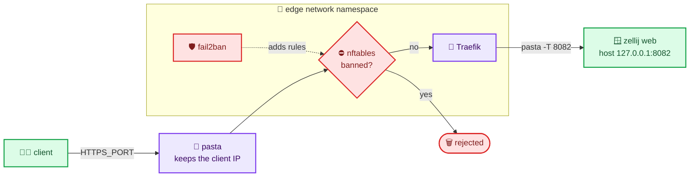

# Fail2ban

fail2ban watches Traefik's access log and bans client IPs that collect too many 4xx responses in a short time: failed zellij logins, wrong dashboard passwords, SSO group denials. A ban blocks the IP at the network level before Traefik sees the connection.

This page covers what counts as a failure, how bans are enforced without root, tuning, unbanning (CLI and dashboard), checking the rules and testing. Every ban also triggers an alert and shows up on the `/stats` dashboard, see [Alerting: ban alerts](alerting.md#ban-alerts).

fail2ban runs as the `fail2ban` container in the compose stack and starts with everything else (`just up`). Nothing has to be installed on the host apart from podman with pasta.

- [How it works](#how-it-works)
- [What counts as a failure](#what-counts-as-a-failure)
- [Where the ban happens](#where-the-ban-happens)
- [Configuration](#configuration)
- [Tuning](#tuning)
- [Unbanning](#unbanning)
- [Checking bans and rules](#checking-bans-and-rules)
- [Testing](#testing)
- [Troubleshooting](#troubleshooting)
- [Reference](#reference)

## How it works

1. Traefik writes one JSON line per request to `access.log` on the `traefik-logs` volume.
2. The `fail2ban` container mounts that volume read-only at `/var/log/traefik/` and runs the `traefik-zellij` filter over every new line.
3. When one IP collects `maxretry` matching lines (default 10) within `findtime` seconds (default 60), the `traefik-zellij` jail bans it for `bantime` seconds (default 3600).
4. The ban is an nftables rule in the `edge` network namespace, where Traefik listens. Packets from the banned IP are rejected there and never reach Traefik.
5. Bans are stored in fail2ban's SQLite database on the `fail2ban-data` volume. The alerter reads that database read-only for [ban alerts](alerting.md#ban-alerts) and the dashboard.

## What counts as a failure

The filter matches any access log line whose `DownstreamStatus` is a 4xx. Status 0 (WebSocket connections), 101, 2xx, 3xx and 5xx never count.

| Response | Where it comes from | Counts |
|---|---|---|
| `401` on `/command/login` | zellij rejecting a login token | yes |
| `401` on `/stats` | wrong or missing basic-auth credentials (`STATS_USERNAME`) | yes |
| `403` at `/oauth2/callback` | user not in `SSO_ALLOWED_GROUPS` ([SSO](sso.md)) | yes |
| `429` | Traefik's `rate-limit` middleware (20 req/s average, burst 50) | yes |
| `400`/`403` on `/stats/api/unban` | malformed or cross-site unban requests | yes |
| `302` to the IdP | SSO on, user not signed in yet | no |
| `200` for unknown paths | zellij answers 200 for any path it doesn't know | no |
| `0` | WebSocket terminal sessions | no |
| `5xx` | backend down, e.g. zellij not running | no |

zellij answers 200 for unknown paths, so a scanner probing for `/wp-login.php` or `/.env` doesn't get banned for that alone. In practice bans come from failed logins and unauthenticated requests.

Visiting `/stats` with basic auth costs one failure per visit: the browser's first request has no credentials and gets a 401 before it asks for the password.

Connections from the host itself show up with the host's own address (see [below](#where-the-ban-happens)) and are ignored through fail2ban's default `ignoreself`, so you can't ban yourself from the machine the stack runs on.

## Where the ban happens

Rootless podman can't touch the host firewall, but each network namespace has its own nftables rules, and a container with `NET_ADMIN` can change the rules of the namespace it's in. The stack uses that:

- **`edge`** owns a network namespace (podman's pasta network) and the published ports (`HTTP_PORT`, `HTTPS_PORT`). It runs nothing but a sleep loop: read-only, all capabilities dropped.
- **Traefik** and **fail2ban** both join that namespace (`network_mode: "service:edge"`).
- **fail2ban** (with `NET_ADMIN` and `NET_RAW`) adds its `nftables-allports` rules there. Only Traefik listens in that namespace, so "all ports" means Traefik's ports. The action covers TCP, and its default `reject` target turns the banned client's connection away before Traefik accepts it.



Details that matter:

- **Real client IPs.** pasta keeps the original source address, so Traefik logs, and fail2ban bans, the real client. Local connections show up as the host's own LAN address rather than `127.0.0.1`, because pasta gives the namespace the host's addresses. fail2ban's `ignoreself` therefore ignores them.
- **Host loopback.** zellij (`127.0.0.1:8082`), the alerter (`127.0.0.1:8083`) and oauth2-proxy (`127.0.0.1:SSO_PROXY_PORT`) listen on the host's loopback. pasta's `-T` option forwards those ports from inside the namespace. If Traefik has to reach anything else on the host's loopback, add it with `EDGE_PASTA_EXTRA`, e.g. `EDGE_PASTA_EXTRA=,-T,9091` for an Authelia on `127.0.0.1:9091` ([SSO: forward-auth mode](sso.md#forward-auth-mode)).
- **Not on the host.** The rules live in the `edge` namespace. `sudo nft list ruleset` on the host doesn't show them, and they don't affect anything else on the machine.
- **Restarts.** A container that joins another container's namespace loses its network when the owner goes away. That's why `edge` owns the namespace rather than Traefik, which gets restarted more often. Traefik can restart freely and the ban rules stay in place. fail2ban re-applies the active bans from its database when it starts again. Podman also won't remove `edge` while the others are joined, so containers can't be recreated in place: `just restart` and `just upgrade` stop everything (`down`) and start it again. Avoid `podman compose up -d --force-recreate`, which with docker-compose tries to replace `edge` first, fails, and leaves the stack without a network.
- **Requirements.** pasta (package `passt`, the default rootless network since podman 5) and nftables inside user namespaces, which current kernels allow. Neither needs root.

## Configuration

The configuration lives in the repo and is mounted read-only into the container (`:ro,z`, see [SELinux](selinux.md)):

| File | Purpose |
|---|---|
| `fail2ban/filter.d/traefik-zellij.conf` | `failregex` that matches 4xx lines in Traefik's JSON log |
| `fail2ban/jail.d/traefik-zellij.conf` | the `traefik-zellij` jail: log path, thresholds, ban action |

The filter:

```ini
failregex = "ClientAddr":"<ADDR>:\d+".*?"DownstreamStatus":4\d\d,
```

It is kept cheap on purpose, because fail2ban runs it on every access log line (about 2 KB each):

- No leading `.*`. A leading `.*` makes Python retry the match from every position in the line. The old filter had one and cost about 19% of a CPU core at 20 requests/s; the current one stays under 2% at that rate and matches the same lines. The numbers are in [Performance: fail2ban filter](performance.md#fail2ban-filter).
- `<ADDR>` instead of `<HOST>`: `ClientAddr` is always an IP, so no DNS handling is needed.
- Not anchored to the start of the line, so a new Traefik field that sorts before `ClientAddr` can't silently switch bans off.
- Traefik escapes quotes inside values (`\"`), so a client can't smuggle a fake `"ClientAddr"` or `"DownstreamStatus"` into the line through a header or the path.

If you change the filter, run `just test-filter` (see [Testing](#testing)). A broken filter fails silently: nothing gets banned and nothing complains.

After editing either file, restart fail2ban:

```bash
podman compose restart fail2ban
```

## Tuning

All thresholds are in `fail2ban/jail.d/traefik-zellij.conf`:

| Setting | Default | Meaning |
|---|---|---|
| `maxretry` | `10` | 4xx responses within `findtime` that trigger a ban |
| `findtime` | `60` | sliding window in seconds |
| `bantime` | `3600` | first ban's duration in seconds (1 hour); a negative value bans permanently |
| `bantime.increment` | `true` | repeat offenders get longer bans: 1h, 2h, 4h, ... (doubling per earlier ban in the history) |
| `bantime.maxtime` | `604800` | longest ban the increment can reach (1 week) |
| `action` | `nftables-allports[name=traefik-zellij]` | ban action, see [Where the ban happens](#where-the-ban-happens) |

To never ban certain addresses, e.g. your office network, add an `ignoreip` line to the jail:

```ini
ignoreip = 127.0.0.1/8 ::1 192.0.2.0/24
```

The increment works off fail2ban's ban history, which it keeps for `F2B_DB_PURGE_AGE` (default `7d`, set in `.env`). An unban from the dashboard or `just fail2ban-unban` deletes that IP's history, so its next ban starts at one hour again.

Apply changes with `podman compose restart fail2ban`.

## Unbanning

### From the command line

```bash
just fail2ban-unban 203.0.113.9
```

This runs `fail2ban-client set traefik-zellij unbanip <ip>` in the `secure-zellij-fail2ban` container. CLI unbans bypass the alerter: no [unban alert](alerting.md#unban-alerts) is sent and the dashboard doesn't record who lifted the ban.

### Unbanning from the dashboard

Active bans in the **fail2ban Bans** table on `/stats` have an **unban** button. It asks for confirmation, lifts the ban, and keeps the row as *unbanned by &lt;user&gt;*. fail2ban deletes a ban from its database once it's lifted, so the alerter records the unban in its own `stats.db`. Every dashboard unban sends an [unban alert](alerting.md#unban-alerts).

The button is only offered when the page has a login: set `STATS_USERNAME`/`STATS_PASSWORD`, or turn on [SSO](sso.md). Without either, anyone who can reach `/stats` could unban themselves, and the dashboard shows a hint instead of the button. The user recorded as having unbanned is the SSO user if there is one, otherwise the basic-auth user. Set `UNBAN_ENABLED=false` to remove the button.

```mermaid
flowchart LR
    browser["🧑‍💻 dashboard<br/>unban button"] -- "POST /stats/api/unban" --> alerter["🔔 alerter"]
    alerter -- "📝 request file<br/>(tmpfs volume)" --> helper["🔓 fail2ban-unban<br/>no network, read-only"]
    helper -- "fail2ban-client set #lt;jail#gt; unbanip #lt;ip#gt;" --> sock[("🔌 fail2ban socket")]
    sock --> f2b["🛡️ fail2ban"]

    classDef app fill:#dbeafe,stroke:#2563eb,stroke-width:2px,color:#1e3a8a
    classDef guard fill:#fee2e2,stroke:#dc2626,stroke-width:2px,color:#7f1d1d
    classDef store fill:#f1f5f9,stroke:#64748b,stroke-width:2px,color:#1e293b

    class browser,alerter app
    class helper,f2b guard
    class sock store
```



How it's put together, and why:

- **The alerter never gets fail2ban's control socket.** Whoever controls that socket controls fail2ban, including the shell commands its actions run. The alerter is reachable through `/stats` and parses attacker-controlled log lines, so all it can do is write a small `{"jail": ..., "ip": ...}` request file to the `unban-requests` volume and wait up to 10 seconds for the answer.
- **`fail2ban-unban` does the work.** It runs `fail2ban/unban-helper.py` from the fail2ban image with no network, a read-only filesystem, all capabilities dropped and `no-new-privileges`. The only command it runs is `fail2ban-client set <jail> unbanip <ip>`, for a jail listed in `UNBAN_JAILS` (default `traefik-zellij`) and a value that parses as an IP address. It is the only container besides fail2ban that mounts the socket volume (`fail2ban-run`).
- **Cross-site requests are refused.** Browsers send basic-auth credentials and the SSO cookie with requests from other sites too. The endpoint therefore requires an `X-Requested-With: secure-zellij` header and a JSON body, which force a CORS preflight that the alerter never answers. It also rejects requests whose `Origin` doesn't match the host or whose `Sec-Fetch-Site` isn't `same-origin`.
- **No accidental self-ban.** An unban that fails (the IP isn't banned, the helper didn't answer) answers 200 with an error message in the body. A 4xx would count towards fail2ban banning the admin.
- **Nothing persists.** The request and socket volumes are tmpfs, so nothing in them outlives the stack. They're mounted with `:z` so podman relabels them on SELinux hosts; without it fail2ban can't create its socket and quietly stops banning. Details in [SELinux](selinux.md).

> [!NOTE]
> The alerter's port `127.0.0.1:8083` bypasses Traefik, so anyone with a shell on the host can reach the API directly. With basic auth set they still need the password. With SSO only, the alerter can't tell a real identity header from a forged one on that port, so local users can unban. Set `STATS_USERNAME`/`STATS_PASSWORD` as well if that matters to you.

## Checking bans and rules

```bash
just fail2ban-status     # jail status: currently failed, total failed, banned IPs
just fail2ban-banned     # banned IPs with ban time and expiry
```

The nftables rules fail2ban created (table `f2b-table`, sets `addr-set-traefik-zellij` and `addr6-set-traefik-zellij`):

```bash
podman exec secure-zellij-fail2ban nft list table inet f2b-table
```

`podman exec secure-zellij-fail2ban nft list ruleset` shows everything in the `edge` namespace. The host's `sudo nft list ruleset` doesn't show these rules, which is expected.

fail2ban's own log:

```bash
podman logs -f secure-zellij-fail2ban
```

At the default `INFO` level it logs every matched line (`Found <ip>`) and every ban and unban.

## Testing

| Command | What it checks |
|---|---|
| `just test-filter` | `tests/fail2ban-filter.sh` runs the filter through `fail2ban-regex` over `tests/fixtures/traefik-access.log` and compares the result with `traefik-access.expected`: 4xx are banned; 0, 101, 3xx and 5xx aren't; IPv6 works; no IP gets in through a header or path value. |
| `just test-ban` | `tests/ban-e2e.sh` starts real Traefik and fail2ban (the repo's filter, jail and nftables action) in a throwaway `edge` namespace laid out like `compose.yaml`. It checks that a client collecting 401s gets banned and then can't connect, that the ban survives a Traefik restart, and that unbanning lets the client back in. Needs pasta. |
| `just test-unban` | `tests/unban-e2e.sh` runs real fail2ban (with a no-op ban action), the `fail2ban-unban` helper and the alerter, and drives the dashboard's unban endpoint. |

All three use throwaway `sz-*` containers on spare ports, leave the running stack alone, and run in CI.

## Troubleshooting

| Symptom | Cause / fix |
|---|---|
| Nothing ever gets banned | Check `just fail2ban-status` and that `podman ps` shows `secure-zellij-fail2ban` as `healthy`. If you changed the filter, run `just test-filter`. If you're testing from the host itself, `ignoreself` ignores you; test from another machine. |
| Scanning random paths doesn't trigger a ban | Expected: zellij answers 200 for unknown paths. Only 4xx count, see [What counts as a failure](#what-counts-as-a-failure). |
| You banned yourself | From a shell on the host: `just fail2ban-unban <ip>`. Or use the dashboard unban button from another address. |
| `fail2ban` shows `unhealthy` | The fail2ban server exited while the container kept running. On SELinux hosts this is usually the socket volume label, see [SELinux](selinux.md). Otherwise check `podman logs secure-zellij-fail2ban`. |
| Dashboard says *the unban helper didn't answer* | `secure-zellij-fail2ban-unban` isn't running or can't reach the socket. Check `podman ps` and `just selinux-check`. |
| Dashboard shows a hint instead of the unban button | `UNBAN_ENABLED=false`, or the page has no login (set `STATS_USERNAME`/`STATS_PASSWORD` or enable SSO). |
| Bans list the host's LAN address | Those are connections from the host itself, see [Where the ban happens](#where-the-ban-happens). |
| Site unreachable after `edge` was recreated | Traefik and fail2ban lost their namespace. Run `just restart`. |
| `sudo nft list ruleset` on the host shows no bans | Expected, the rules are in the `edge` namespace. Use the commands in [Checking bans and rules](#checking-bans-and-rules). |

## Reference

Variables in `.env` that affect banning and unbanning:

| Variable | Default | Description |
|---|---|---|
| `EDGE_PASTA_EXTRA` | empty | extra pasta options for the `edge` namespace, e.g. `,-T,9091` to forward another host-loopback port |
| `UNBAN_ENABLED` | `true` | offer the unban button on `/stats` (only when the page has a login) |
| `BAN_ALERTS` | `true` | send an alert for every ban, see [Alerting](alerting.md#ban-alerts) |
| `TZ` | `UTC` | timezone of the fail2ban container |
| `F2B_LOG_LEVEL` | `INFO` | `CRITICAL`, `ERROR`, `WARNING`, `NOTICE`, `INFO` or `DEBUG` |

`UNBAN_JAILS` (default `traefik-zellij`) is set on the `fail2ban-unban` service in `compose.yaml`. If you add a jail and want it unbannable from the dashboard, add it there, comma-separated.

Containers and volumes involved:

| Name | Role |
|---|---|
| `secure-zellij-edge` | owns the network namespace and published ports |
| `secure-zellij-fail2ban` | reads the access log, holds the nftables rules |
| `secure-zellij-fail2ban-unban` | carries out dashboard unbans |
| `traefik-logs` | Traefik's access log, read-only for fail2ban and the alerter |
| `fail2ban-data` | fail2ban's SQLite database, read-only for the alerter |
| `fail2ban-run` | tmpfs, fail2ban's control socket |
| `unban-requests` | tmpfs, unban requests from the alerter to the helper |
