# Fail2ban

Fail2ban watches the Traefik access log and bans IPs that rack up repeated 4xx responses — failed token attempts, scanners, probes. The alerter notifies you; fail2ban acts. Every ban also sends an alert and shows up on the `/stats` dashboard, see [Alerting: ban alerts](alerting.md#ban-alerts).

It runs as a container in the compose stack. No host packages needed — it starts with the rest of the stack via `just up`.

## How it works

The `fail2ban` service mounts the shared `traefik-logs` volume read-only at `/var/log/traefik/` and reads `access.log`. When an IP exceeds `maxretry` 4xx responses within `findtime` seconds it is banned via iptables for `bantime` seconds.

Because fail2ban modifies host iptables, the container runs with `network_mode: host` and the `NET_ADMIN` + `NET_RAW` capabilities. This is intentional.

## Configuration (GitOps)

Configs live in `fail2ban/` in the repo and are mounted into the container read-only:

- `fail2ban/filter.d/traefik-zellij.conf` — regex that matches 4xx log lines
- `fail2ban/jail.d/traefik-zellij.conf` — ban thresholds and action

To change behaviour, edit the files and restart the container:

```bash
podman compose restart fail2ban
```

## Commands

```bash
# Jail status (banned count, total hits)
just fail2ban-status

# List currently banned IPs with ban times
just fail2ban-banned

# Unban a specific IP
just fail2ban-unban 1.2.3.4
```

## Unbanning from the dashboard

Active bans on `/stats` have an **unban** button. It asks for confirmation, lifts the ban, and keeps the row as *unbanned by &lt;user&gt;*. fail2ban itself forgets a ban once it's lifted, so the alerter keeps that record in its own database. Every unban also sends an [unban alert](alerting.md#unban-alerts).

The button only appears when the page has a login: set `STATS_USERNAME`/`STATS_PASSWORD`, or turn on [SSO](sso.md). Without either, anyone who can reach `/stats` could unban themselves. The person shown as having unbanned is the SSO user if there is one, otherwise the basic-auth user. Turn it off with `UNBAN_ENABLED=false`.



```mermaid
flowchart LR
    browser["🧑‍💻 dashboard<br/>unban button"] -- "POST /stats/api/unban" --> alerter["🔔 alerter"]
    alerter -- "📝 request file<br/>(tmpfs volume)" --> helper["🔓 fail2ban-unban<br/>no network, read-only"]
    helper -- "fail2ban-client set #lt;jail#gt; unbanip #lt;ip#gt;" --> sock[("🔌 fail2ban socket")]
    sock --> f2b["🛡️ fail2ban"]

    classDef app fill:#dbeafe,stroke:#2563eb,stroke-width:2px,color:#1e3a8a
    classDef guard fill:#fee2e2,stroke:#dc2626,stroke-width:2px,color:#7f1d1d
    classDef store fill:#f1f5f9,stroke:#64748b,stroke-width:2px,color:#1e293b

    class browser,alerter app
    class helper,f2b guard
    class sock store
```

How it's put together, and why:

- **The alerter never gets fail2ban's control socket.** That socket is full control over fail2ban, including the shell commands its actions run as root. The alerter faces the internet through `/stats` and parses attacker-controlled log lines, so it only writes a small `{"jail", "ip"}` request file.
- **`fail2ban-unban` does the work.** It runs from the fail2ban image with no network, a read-only filesystem, all capabilities dropped and `no-new-privileges`. The only command it runs is `fail2ban-client set <jail> unbanip <ip>`, for a jail listed in `UNBAN_JAILS` (default `traefik-zellij`) and a value that parses as an IP address.
- **Cross-site requests are refused.** Browsers send basic-auth credentials and the SSO cookie with requests from other sites too. The endpoint therefore needs a custom header and a JSON body, which force a CORS preflight that the alerter never answers. It also checks `Origin` and `Sec-Fetch-Site`.
- **No accidental self-ban.** A failed unban (e.g. the IP isn't banned) answers 200 with an error message. A 4xx would count towards fail2ban banning the admin.
- The request and socket volumes are tmpfs, so nothing in them outlives the stack.

One thing to know: the alerter's port `127.0.0.1:8083` skips Traefik, so local users on the host can reach the API directly. With basic auth set they still need the password. With SSO only, the alerter can't tell a real SSO header from a forged one on that port, so anyone with a shell on the host can unban. Set `STATS_USERNAME`/`STATS_PASSWORD` too if that matters to you.

Test it with `just test-unban`. This runs real fail2ban (with a no-op ban action), the helper and the alerter in throwaway containers, and also runs in CI.

## Tuning

All thresholds are in `fail2ban/jail.d/traefik-zellij.conf`:

| Parameter  | Default | Meaning                                          |
|------------|---------|--------------------------------------------------|
| `maxretry` | 10      | 4xx responses within `findtime` to trigger a ban |
| `findtime` | 60      | Sliding window in seconds                        |
| `bantime`  | 3600    | Ban duration in seconds (1 hour)                 |

After editing, apply with:

```bash
podman compose restart fail2ban
```

## nftables

If the host uses nftables instead of iptables, change the `action` line in `fail2ban/jail.d/traefik-zellij.conf`:

```ini
action = nftables-multiport[name=traefik-zellij, port="http,https"]
```
