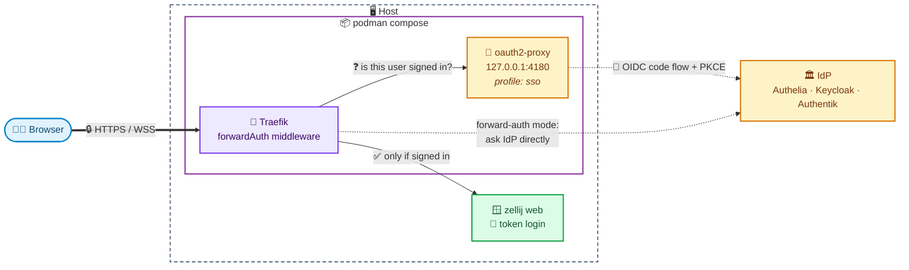
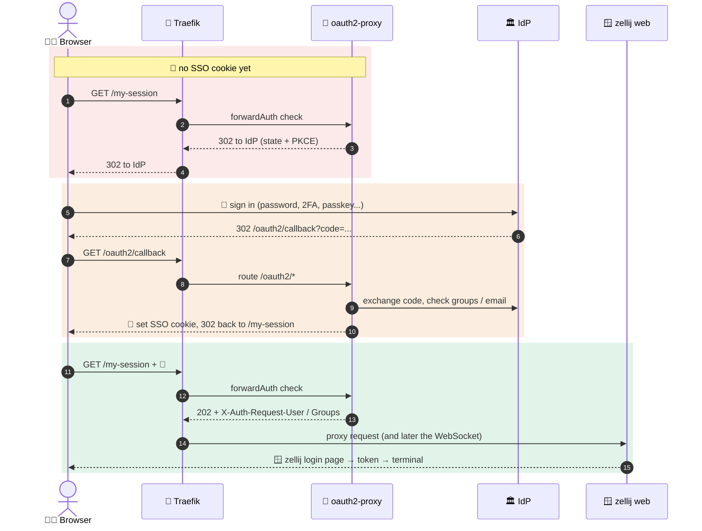

# SSO (Authelia, Keycloak, Authentik)

Put a single sign-on login in front of the zellij web terminal and the `/stats` dashboard. Anyone without a valid SSO session gets sent to your identity provider (IdP) before a single byte reaches zellij.

SSO is **off by default**. Nothing changes for an existing install until you set `SSO_MODE`.

> [!IMPORTANT]
> **zellij still asks for its login token.** zellij (0.46) has no option to turn off token auth or to trust an identity header from a reverse proxy. Upstream: [#5658](https://github.com/zellij-org/zellij/issues/5658) (trusted proxy header, postponed), [#4563](https://github.com/zellij-org/zellij/issues/4563) (disable token, open). With SSO enabled the login page itself is no longer reachable from the internet, which is the main win: the token becomes a second factor instead of the only one.

- [Pick a mode](#pick-a-mode)
- [How it works](#how-it-works)
- [Before you start](#before-you-start)
- [oauth2-proxy mode](#oauth2-proxy-mode)
  - [Authelia](#authelia-oidc)
  - [Keycloak](#keycloak)
  - [Authentik](#authentik-oidc)
- [forward-auth mode](#forward-auth-mode)
  - [Authelia](#authelia-forward-auth)
  - [Authentik](#authentik-forward-auth)
- [Restricting who gets in](#restricting-who-gets-in)
- [Sessions and WebSockets](#sessions-and-websockets)
- [Who connected](#who-connected)
- [Checking the setup](#checking-the-setup)
- [Troubleshooting](#troubleshooting)
- [Reference: all SSO variables](#reference-all-sso-variables)

## Pick a mode

| | `SSO_MODE=oauth2-proxy` | `SSO_MODE=forward-auth` |
|---|---|---|
| **How** | Bundled [oauth2-proxy](https://oauth2-proxy.github.io/oauth2-proxy/) container speaks OIDC to your IdP | Traefik asks your IdP's own forward-auth endpoint directly |
| **Authelia** | ✅ | ✅ simplest if Authelia already guards other apps |
| **Keycloak** | ✅ | ❌ Keycloak has no forward-auth endpoint |
| **Authentik** | ✅ | ✅ via the embedded outpost |
| **Any other OIDC IdP** | ✅ (Pocket ID, Zitadel, Entra, Google, ...) | ❌ |
| **IdP on another domain** | ✅ any domain | ⚠️ Authelia needs a shared parent domain |
| **Extra container** | `oauth2-proxy` (compose profile `sso`) | none |

When in doubt, use **oauth2-proxy**: one setup that works the same way with every IdP.

## How it works



The login, step by step (oauth2-proxy mode):



What the stack does for you:

- **Both routers protected.** The `sso` middleware is added to the zellij router and the `/stats` router.
- **Redirects, not 401s.** Unauthenticated browsers get a `302` to the IdP, never a `401`. fail2ban, which bans on repeated `4xx`, doesn't punish people for simply not being logged in yet. A user outside the allowed groups gets a `403` at the callback, and those do count.
- **Identity headers.** The signed-in user is passed to the backend as `X-Auth-Request-User`, `-Email`, `-Preferred-Username` and `-Groups` (oauth2-proxy mode), or as `Remote-*` (Authelia) and `X-authentik-*` (Authentik) headers. zellij ignores them today.
- **Spoofed headers dropped.** Client-supplied `X-Forwarded-*` headers are stripped by the entrypoint, and look-alike headers such as `X_Auth_Request_User` are dropped too (`aliasHeadersStrategy: delete`).
- **No cookies in the log.** The `Cookie` and `Authorization` headers are redacted in the access log, so session cookies never land on disk.

## Before you start

1. **A real hostname and HTTPS.** The SSO cookie is `Secure`, and IdPs reject non-HTTPS redirect URIs. Use [Let's Encrypt](tls.md) or another trusted cert. A self-signed cert works for testing, but your browser has to trust it.
2. **The exact callback URL.** In oauth2-proxy mode it is:
   ```
   https://<DOMAIN>[:<HTTPS_PORT>]/oauth2/callback
   ```
   Include the port only when `HTTPS_PORT` is not `443`, e.g. `https://term.example.com:8443/oauth2/callback`. `just sso-check` prints the exact value.
3. **The IdP must be reachable from this host.** oauth2-proxy talks to the IdP's issuer URL from the server, not only from the browser.
4. **Let's Encrypt users.** The SSO routers in `traefik/sso/*.yml` use `tls: {}` just like `traefik/dynamic/routers.yml`. Swap them to `certResolver: letsencrypt` the same way.

## oauth2-proxy mode

Common `.env` part for every IdP:

```env
SSO_MODE=oauth2-proxy
SSO_PROVIDER_NAME=Authelia            # only cosmetic
SSO_OIDC_ISSUER_URL=https://auth.example.com
SSO_CLIENT_ID=secure-zellij
SSO_CLIENT_SECRET=<from your IdP>
SSO_COOKIE_SECRET=<output of: just sso-cookie-secret>
SSO_ALLOWED_GROUPS=zellij             # recommended, see "Restricting who gets in"
```

Then:

```bash
just sso-check   # validates the variables and fetches the IdP's discovery document
just up          # starts the stack; adds the oauth2-proxy container automatically
just logs-sso    # follow oauth2-proxy
```

`just up` and the other recipes add `--profile sso` automatically when `SSO_MODE=oauth2-proxy`. When running compose by hand, use `podman compose --profile sso up -d`.

### Authelia (OIDC)

Tested pairing upstream: Authelia v4.39 + oauth2-proxy v7.15 ([Authelia's oauth2-proxy guide](https://www.authelia.com/integration/openid-connect/clients/oauth2-proxy/)).

**1. Generate the client secret.** The command prints a random password and its hash: the password goes into `.env`, the hash into Authelia.

```bash
podman run --rm docker.io/authelia/authelia:4.39.28 \
  authelia crypto hash generate pbkdf2 --variant sha512 --random --random.length 72 --random.charset rfc3986
```

**2. Add the client** to Authelia's `configuration.yml`:

```yaml
identity_providers:
  oidc:
    clients:
      - client_id: 'secure-zellij'
        client_name: 'secure-zellij'
        client_secret: '$pbkdf2-sha512$310000$...'   # the digest from step 1
        public: false
        authorization_policy: 'two_factor'
        consent_mode: 'pre-configured'              # skip the consent screen after the first time
        pre_configured_consent_duration: '1 month'
        require_pkce: true
        pkce_challenge_method: 'S256'
        redirect_uris:
          - 'https://term.example.com/oauth2/callback'
        scopes: ['openid', 'email', 'profile', 'groups']
        response_types: ['code']
        grant_types: ['authorization_code']
        access_token_signed_response_alg: 'none'
        userinfo_signed_response_alg: 'none'
        token_endpoint_auth_method: 'client_secret_basic'
```

Restart Authelia.

**3. `.env`:**

```env
SSO_MODE=oauth2-proxy
SSO_PROVIDER_NAME=Authelia
SSO_OIDC_ISSUER_URL=https://auth.example.com   # Authelia root URL, no path
SSO_CLIENT_ID=secure-zellij
SSO_CLIENT_SECRET=<plaintext password from step 1>
SSO_COOKIE_SECRET=<just sso-cookie-secret>
SSO_OIDC_SCOPE=openid email profile groups     # Authelia only sends groups for this scope
SSO_ALLOWED_GROUPS=zellij
```

Notes:

- Authelia delivers `email`, `email_verified` and `groups` through the userinfo endpoint, not the ID token. oauth2-proxy fetches userinfo automatically, so nothing else is needed.
- `email_verified` is always `true` in Authelia, so leave `SSO_ALLOW_UNVERIFIED_EMAIL` alone.

### Keycloak

Tested against Keycloak 26.x. The steps use the admin console ([oauth2-proxy Keycloak docs](https://oauth2-proxy.github.io/oauth2-proxy/configuration/providers/keycloak_oidc)).

**1. Create the client.** In your realm, go to **Clients → Create client**:

1. **General settings**
   - Client type: `OpenID Connect`
   - Client ID: `secure-zellij`
2. **Capability config**
   - Client authentication: **On** (this makes it a confidential client)
   - Standard flow: **On**
   - Direct access grants: **Off**
   - PKCE method: `S256`. Optional: leaving it blank still works, because oauth2-proxy always sends PKCE.
3. **Login settings**
   - Valid redirect URIs: `https://term.example.com/oauth2/callback`. Use the exact URL; avoid wildcards.
   - Web origins: leave empty.
4. Save. Copy the secret from the **Credentials** tab.

**2. Put group membership into the token.** Go to **Clients → secure-zellij → Client scopes → secure-zellij-dedicated → Configure a new mapper → Group Membership**:

- Name: `groups`
- Token Claim Name: `groups`
- Full group path: **Off**. Otherwise the groups arrive as `/zellij` rather than `zellij`.
- Add to ID token, Add to access token, Add to userinfo: **On**

The dedicated scope is always included, so you don't need to request an extra `groups` scope.

> [!WARNING]
> Don't add `groups` to `SSO_OIDC_SCOPE` for Keycloak unless you also created and attached a client scope with that name. Keycloak rejects unknown scopes with `invalid_scope`.

**3. Audience mapper (recommended by oauth2-proxy).** In the same dedicated scope, add a mapper → **By configuration → Audience**:

- Name: `aud-secure-zellij`
- Included Client Audience: `secure-zellij`
- Add to ID token: **On**
- Add to access token: **On**

**4. Create the group.** Go to **Groups → Create group** `zellij` and add your users to it.

**5. `.env`:**

```env
SSO_MODE=oauth2-proxy
SSO_PROVIDER=keycloak-oidc                     # or oidc, both work
SSO_PROVIDER_NAME=Keycloak
SSO_OIDC_ISSUER_URL=https://keycloak.example.com/realms/<realm>
SSO_CLIENT_ID=secure-zellij
SSO_CLIENT_SECRET=<Credentials tab>
SSO_COOKIE_SECRET=<just sso-cookie-secret>
SSO_ALLOWED_GROUPS=zellij
```

Notes:

- Users created in the admin console have **Email verified = Off**, and oauth2-proxy refuses them ("email in id_token isn't verified"). Either turn on Email verified for each user, or set `SSO_ALLOW_UNVERIFIED_EMAIL=true`.
- Users need an email address at all; oauth2-proxy refuses accounts without one.

### Authentik (OIDC)

Tested against Authentik 2026.x ([OAuth2 provider docs](https://docs.goauthentik.io/add-secure-apps/providers/oauth2/)).

**1. Create the application and provider.** Go to **Applications → Applications → New Application**:

1. **Application**
   - Name: `secure-zellij`
   - Slug: `secure-zellij`
2. **Provider type:** `OAuth2/OpenID Provider`
3. **Provider settings**
   - Authorization flow: your usual one, e.g. *default-provider-authorization-implicit-consent*
   - Client type: `Confidential`
   - Redirect URIs: matching mode **Strict**, URL `https://term.example.com/oauth2/callback`. Don't leave the list empty: Authentik then saves whatever redirect URI it sees first.
   - Signing key: **pick one**, e.g. *authentik Self-signed Certificate*. Without one, tokens are HS256-signed with the client secret and there are no public keys for oauth2-proxy to verify against.
4. Copy the client ID and client secret.

**2. Restrict access** (optional, in addition to `SSO_ALLOWED_GROUPS`): on the application's **Policy / Group / User Bindings** tab, bind the `zellij` group.

**3. `.env`:**

```env
SSO_MODE=oauth2-proxy
SSO_PROVIDER_NAME=Authentik
SSO_OIDC_ISSUER_URL=https://authentik.example.com/application/o/secure-zellij/   # keep the trailing slash
SSO_CLIENT_ID=<client id>
SSO_CLIENT_SECRET=<client secret>
SSO_COOKIE_SECRET=<just sso-cookie-secret>
SSO_ALLOWED_GROUPS=zellij
SSO_ALLOW_UNVERIFIED_EMAIL=true   # see below
```

Notes:

- **`email_verified`.** Since Authentik 2025.10 the default `email` scope mapping returns `email_verified: false`, and oauth2-proxy then refuses every login. You have two fixes:
  - set `SSO_ALLOW_UNVERIFIED_EMAIL=true` (simplest), or
  - follow [Authentik's guide](https://docs.goauthentik.io/add-secure-apps/providers/oauth2/verify-email-address/) to create a custom email mapping that returns `true`. Swap it in for the default on the provider; don't assign both.
- **groups.** The `groups` claim comes from the default `profile` scope as plain group names, so `SSO_ALLOWED_GROUPS=zellij` matches directly.

## forward-auth mode

Traefik asks the IdP directly. There is no oauth2-proxy container and no `/oauth2/` route.

### Authelia (forward-auth)

Based on [Authelia's Traefik guide](https://www.authelia.com/integration/proxies/traefik/).

**1. Cookie domain.** Authelia's session cookie must cover both Authelia and zellij, so they need a shared parent domain, e.g. `auth.example.com` and `term.example.com`:

```yaml
session:
  cookies:
    - domain: 'example.com'
      authelia_url: 'https://auth.example.com'
      default_redirection_url: 'https://term.example.com'
```

**2. Access rule:**

```yaml
access_control:
  default_policy: 'deny'
  rules:
    - domain: 'term.example.com'
      policy: 'two_factor'
      subject: ['group:zellij']
```

**3. `.env`.** Use whatever URL reaches Authelia from this host. Traefik runs with host networking, so it can be `127.0.0.1` or the public URL.

```env
SSO_MODE=forward-auth
SSO_FORWARD_AUTH_URL=http://127.0.0.1:9091/api/authz/forward-auth
```

Limitation: access via `EXTRA_DOMAINS` entries such as a LAN IP won't work, because Authelia can't set a cookie for an IP. Use the hostname.

### Authentik (forward-auth)

Based on Authentik's [proxy provider](https://docs.goauthentik.io/add-secure-apps/providers/proxy/forward_auth/) and [Traefik](https://docs.goauthentik.io/add-secure-apps/providers/proxy/server_traefik/) docs.

**1. Create the application and provider.** Go to **Applications → Applications → New Application**, provider type **Proxy Provider**:

- Mode: **Forward auth (single application)**
- External host: `https://term.example.com`. Include the port if `HTTPS_PORT` isn't 443.

**2. Outpost.** Go to **Applications → Outposts → authentik Embedded Outpost → Edit** and add the application.

**3. `.env`.** Authentik also needs `/outpost.goauthentik.io/` routed on the zellij hostname, which is what the callback variables are for:

```env
SSO_MODE=forward-auth
SSO_FORWARD_AUTH_URL=http://authentik.example.com:9000/outpost.goauthentik.io/auth/traefik
SSO_CALLBACK_PREFIX=/outpost.goauthentik.io/
SSO_CALLBACK_URL=http://authentik.example.com:9000
```

The callback router's rule is longer than the zellij router's, so Traefik gives it priority automatically, and it doesn't carry the `sso` middleware.

## Restricting who gets in

Without a restriction, **every account in your IdP** can reach the zellij login page. Restrict it:

| Setting | Example | Effect |
|---|---|---|
| `SSO_ALLOWED_GROUPS` | `zellij,admins` | user must be in at least one group (exact match on the `groups` claim) |
| `SSO_ALLOWED_EMAIL_DOMAINS` | `example.com` | email must end in this domain (default `*`) |
| IdP-side policy | Authelia `access_control`, Authentik bindings, Keycloak client roles | user never gets a token for this client |

In forward-auth mode the restriction lives entirely in the IdP: Authelia `access_control` or Authentik application bindings.

## Sessions and WebSockets

- The SSO session lasts `SSO_COOKIE_EXPIRE` (default `12h`). oauth2-proxy doesn't re-check with the IdP during that time, so revoking a user in the IdP takes effect when their cookie expires.
- An open terminal keeps working after the cookie expires. The WebSocket was authorised when it opened, and Traefik doesn't re-check it.
- **Reconnects** do get checked. A browser WebSocket can't follow a login redirect, so after expiry the terminal just fails to reconnect: reload the page to sign in again. Pick a `SSO_COOKIE_EXPIRE` that covers your usual working day.
- **Sign out:** `https://<DOMAIN>/oauth2/sign_out` clears the SSO cookie (oauth2-proxy mode). It doesn't end the IdP session.

## Who connected

Connection alerts, [fail2ban ban alerts](alerting.md#ban-alerts), webhook payloads and the stats dashboard show the signed-in SSO user next to the IP. See [Alerting: SSO user](alerting.md#sso-user) for which headers are read in each mode.

## Checking the setup

```bash
just sso-check   # variables, cookie secret length, IdP discovery, redirect URI to register
just test-sso    # end-to-end test with a mock IdP in throwaway containers (doesn't touch your stack)
```

`just test-sso` runs `tests/sso-e2e.sh`. It also runs in CI and covers:
- the login redirect, PKCE and the callback;
- group denial;
- forward-auth with a callback route;
- `SSO_MODE=off`;
- header spoofing;
- cookie redaction.

## Troubleshooting

| Symptom | Cause / fix |
|---|---|
| Traefik exits with `entrypoint: SSO_MODE=forward-auth needs SSO_FORWARD_AUTH_URL` | Fill in the variable named in the message. |
| `404` on `/oauth2/callback` | `SSO_MODE` isn't `oauth2-proxy`, or Traefik wasn't restarted after changing it (`just restart`). |
| `502 Bad Gateway` on every page | oauth2-proxy isn't running. Check `just logs-sso`. Was the stack started without `--profile sso`? |
| IdP says *invalid redirect_uri* | The registered URI must match exactly, including the `:port`. See `just sso-check`. |
| `email in id_token (...) isn't verified` | Keycloak users with Email verified off, or Authentik 2025.10+. Set `SSO_ALLOW_UNVERIFIED_EMAIL=true` or fix it in the IdP. |
| `403 Forbidden` after logging in | User isn't in `SSO_ALLOWED_GROUPS`. Check the claim: Keycloak with Full group path on sends `/zellij`; Authelia needs `groups` in `SSO_OIDC_SCOPE`. |
| `invalid_scope` from Keycloak | You requested a scope that isn't attached to the client, usually `groups`. |
| `cookie_secret must be 16, 24, or 32 bytes` | Regenerate with `just sso-cookie-secret`. |
| Login loop | Browser doesn't keep the `Secure` cookie: not real HTTPS, or the cert isn't trusted. Or you're on an `EXTRA_DOMAINS` host the IdP has no redirect URI for. |
| Banned by fail2ban while testing | Repeated `403`s from failed group checks count as 4xx. `just fail2ban-unban <ip>`, see [fail2ban.md](fail2ban.md). |
| Using an internal CA for the IdP | Mount the CA into the oauth2-proxy container, or set `SSO_SKIP_CA_VERIFY=true` for testing only. |

## Reference: all SSO variables

| Variable | Mode | Default | Description |
|---|---|---|---|
| `SSO_MODE` | all | `off` | `off`, `oauth2-proxy` or `forward-auth` |
| `SSO_PROVIDER` | oauth2-proxy | `oidc` | oauth2-proxy provider; `keycloak-oidc` also works for Keycloak |
| `SSO_PROVIDER_NAME` | oauth2-proxy | `SSO` | display name |
| `SSO_OIDC_ISSUER_URL` | oauth2-proxy | — | issuer URL (discovery at `/.well-known/openid-configuration`) |
| `SSO_CLIENT_ID` | oauth2-proxy | — | OIDC client ID |
| `SSO_CLIENT_SECRET` | oauth2-proxy | — | OIDC client secret |
| `SSO_COOKIE_SECRET` | oauth2-proxy | — | 32-byte secret from `just sso-cookie-secret` |
| `SSO_OIDC_SCOPE` | oauth2-proxy | `openid email profile` | add `groups` for Authelia |
| `SSO_GROUPS_CLAIM` | oauth2-proxy | `groups` | claim holding the groups |
| `SSO_ALLOWED_GROUPS` | oauth2-proxy | empty (anyone) | comma-separated groups |
| `SSO_ALLOWED_EMAIL_DOMAINS` | oauth2-proxy | `*` | comma-separated email domains |
| `SSO_ALLOW_UNVERIFIED_EMAIL` | oauth2-proxy | `false` | accept `email_verified: false` |
| `SSO_COOKIE_EXPIRE` | oauth2-proxy | `12h` | SSO session length |
| `SSO_REDIRECT_URL` | oauth2-proxy | per request | fixed callback URL; by default built from the host the browser used |
| `SSO_EXTRA_REDIRECT_DOMAINS` | oauth2-proxy | — | extra hosts allowed as post-login redirect targets (`DOMAIN:*` is always allowed) |
| `SSO_PROXY_PORT` | oauth2-proxy | `4180` | oauth2-proxy listens on `127.0.0.1:<port>` |
| `SSO_SKIP_CA_VERIFY` | oauth2-proxy | `false` | skip TLS verification of the IdP (testing only) |
| `SSO_FORWARD_AUTH_URL` | forward-auth | — | IdP forward-auth endpoint |
| `SSO_CALLBACK_PREFIX` | any | — | extra path routed to the IdP on the zellij host (Authentik: `/outpost.goauthentik.io/`) |
| `SSO_CALLBACK_URL` | any | — | where `SSO_CALLBACK_PREFIX` goes |

The Traefik side lives in `traefik/sso/*.yml`: `traefik/entrypoint.sh` copies in the right file for the mode and adds the `sso` middleware to the zellij and `/stats` routers. Other oauth2-proxy options can be added as `OAUTH2_PROXY_*` lines to the `oauth2-proxy` service in `compose.yaml` ([all options](https://oauth2-proxy.github.io/oauth2-proxy/configuration/overview)).
